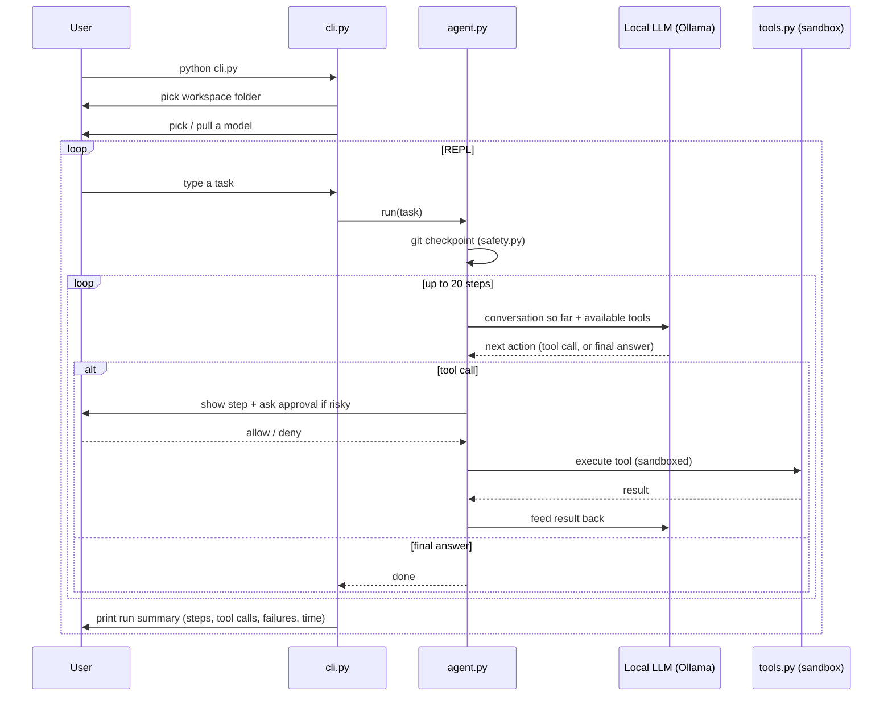

# VA Agent — Technical Overview

## 1. What this is

`va-agent` is a locally-run, autonomous coding assistant. It runs entirely
on the developer's own machine, using a local open-weight LLM (served by
[Ollama](https://ollama.com)) instead of a cloud API. Given a plain-English
task, it reads, writes, searches, and runs commands inside a sandboxed
project folder — asking for human approval before anything risky, and
recording a git checkpoint before every task so changes can always be
undone.

It is a small-scale version of the same idea behind tools like Claude Code
or GitHub Copilot Workspace, built to run 100% locally/offline.

## 2. Repository map

| File | Responsibility |
|---|---|
| `va-agent/cli.py` | Entry point. Starts the REPL, lets the user pick a workspace folder and a model, and handles in-session commands (`help`, `workspace`, `model`, `exit`). |
| `va-agent/agent.py` | The core agent loop: builds the system prompt, repeatedly asks the model what to do, dispatches tool calls, and feeds results back until the model finishes or a 20-step cap is hit. |
| `va-agent/tools.py` | The five capabilities the model is allowed to use (list/read/write files, search text, run shell commands), all confined to a sandbox folder. |
| `va-agent/llm.py` | Wraps the Ollama client: sends chat requests, lists/switches/pulls models, and includes fallback logic for models that don't emit tool calls in the expected format. |
| `va-agent/safety.py` | Human-approval gate for risky tool calls, plus git-based checkpointing before each task. |
| `va-agent/ui.py` | All terminal presentation (banner, colored/iconified logs, tables, panels) — kept separate so formatting doesn't clutter the agent logic. |
| `va-agent/mocktest.py` | An offline test that scripts a fake model's responses to exercise the whole agent loop, including deliberate failure cases, without needing Ollama running. |
| `evaluation/run_eval.py` + `evaluation/tasks.json` | A small benchmark harness that runs defined tasks against the agent multiple times and logs results to `results/results.csv`. |
| `Modelfile` | Defines a custom Ollama model (`qwen2.5-coder:7b` with a 32k context window) used as the default local model. |
| `requirements.txt` | Python dependencies (`ollama`, `rich` for the UI, `pandas`/`matplotlib` for evaluation reporting). |

## 3. How a task runs, end to end

Each task is independent — the agent gets a fresh conversation, re-reads
whatever files it needs (it's told to `grep`/`read_file` before editing),
and stops either when it replies with plain text and no further tool
call, or after 20 steps.

## 4. The five tools available to the model

| Tool | Purpose | Guardrail |
|---|---|---|
| `list_files` | List every file under the workspace | Skips `.git`, `node_modules`, `__pycache__`, `.venv` |
| `read_file` | Read a file's contents | Truncated at 50,000 characters |
| `grep` | Regex/text search across the workspace | Capped at 50 matches |
| `write_file` | Create or overwrite a file with complete new content | Requires explicit human approval |
| `run_command` | Run a shell command in the workspace | Requires explicit human approval, 60-second timeout, blocked destructive patterns |

All five are routed through `tools._safe()`, which resolves every path
against the current sandbox root and rejects anything that would escape
it (e.g. `../../etc/passwd`) — so the model cannot touch files outside
the folder the user pointed it at.

## 5. Safety mechanisms

- **Path confinement** — every file operation is resolved and checked
  against the sandbox root; attempts to escape it are rejected.
- **Blocked commands** — `run_command` refuses anything containing known
  destructive patterns (`rm -rf`, `sudo`, `shutdown`, `mkfs`, `dd if=`,
  fork bombs, `> /dev/...`).
- **Human approval** — `write_file` and `run_command` always print what
  they're about to do and wait for a `y/N` confirmation before executing,
  unless the operator explicitly opts into `VA_AUTO_APPROVE=1` (used only
  for automated tests/evaluation, never interactively by default).
- **Git checkpoint per task** — if the workspace is a git repo, the agent
  commits its current state before starting each task, so any run's
  changes can be inspected or reverted with plain `git log` / `git reset`.
- **Step cap** — the loop hard-stops after 20 steps so a confused model
  can't run indefinitely.

## 6. Handling imperfect local models (`llm.py`)

Cloud models like Claude or GPT-4 reliably use structured "tool calling."
Smaller local open-weight models often don't — they sometimes print a
tool call as plain text instead of using the API's structured field, or
hallucinate a fake result right after it. `llm.py` compensates with two
fallback parsers so the agent still works across a range of local models:

1. **`_extract_fallback_call`** — scans the model's raw text for an
   embedded `{"name": ..., "arguments": {...}}` JSON object using a real
   JSON decoder (not a regex), so nested braces don't break it.
2. **`_extract_call_expr`** — recovers pseudo-code like
   `write_file("a.py", "text")` by parsing it with Python's `ast` module
   and never executing (`eval`-ing) it — so it's safe even though it's
   parsing model-generated text.

## 7. Testing and evaluation

- **`mocktest.py`** — a fully offline check. It replaces the LLM with a
  scripted list of canned responses (including deliberate failures: an
  unknown tool name, a path-traversal attempt, a missing argument, and a
  blocked destructive command) and asserts the agent loop handles all of
  them correctly — usable without Ollama or network access, e.g. in CI.
- **`evaluation/run_eval.py`** — a small benchmark harness. For each task
  defined in `evaluation/tasks.json`, it resets the sandbox via git, runs
  the agent three times (auto-approved, quiet), verifies success with a
  task-specific check, and appends timing/step/failure metrics to
  `results/results.csv` — used to track how a given model/prompt setup
  performs over time (`results/charts/` holds derived charts).

## 8. CLI usability

The command-line interface was recently reworked to be approachable for
non-technical users, not just people comfortable reading raw logs:

- A welcome banner explaining what the tool does and what commands exist.
- Icon-coded tool-call logs (📁 📄 📝 🔎 ⚙️) instead of uniform text.
- In-session commands — `help`, `workspace`, `model` — so settings can be
  changed without restarting.
- A colored pass/fail run summary and a boxed panel for the agent's final
  answer.
- Graceful `Ctrl+C` handling mid-task (returns to the prompt instead of
  killing the whole session).

## 9. Environment note

This project sits under `~/Documents`, which is commonly iCloud-synced on
macOS. The first read of a file that iCloud has evicted to the cloud can
occasionally time out (`TimeoutError: [Errno 60]`) while it re-downloads —
this has been observed with `.venv` dependency files and is an OS/sync
artifact, not a defect in the application code. It self-resolves after
the first access re-caches the file locally.

## 10. Tech stack

- **Language**: Python 3.14
- **Model runtime**: Ollama (local), default model `qwen-coder-32k`
  (`qwen2.5-coder:7b` with an extended 32k context window)
- **Terminal UI**: `rich`
- **Evaluation/reporting**: `pandas`, `matplotlib`
